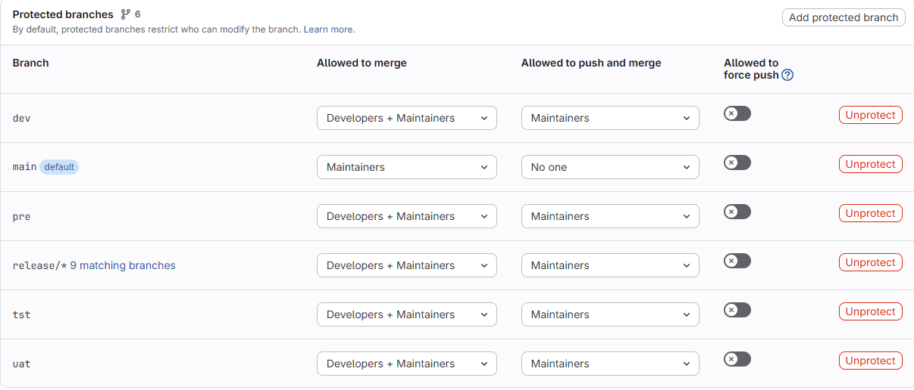
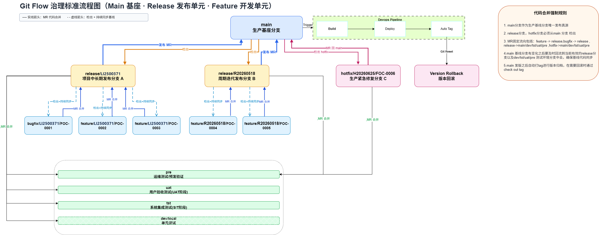
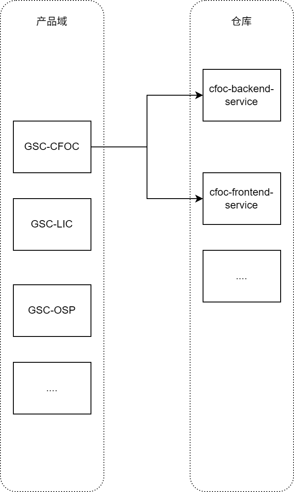

# 代码仓库与分支规范

| 项目 | 内容 |
| --- | --- |
| 规范发布者 | Digital Supply Chain - Engineering Center |
| 规范维护者 | yangzhuang2@lenovo.com |
| 来源 | 用户提供的《代码仓库与分支规范.pdf》，共 12 页，第 12 页为空白 |
| 整理说明 | 按原文章节转写，整理表格、换行和目录树，保留原文的【要求】【建议】【提醒】等级。图示保留原图并附文字说明。 |

> 本文件记录附件中的规范内容；其中的命令、安装建议和操作步骤均为原文资料，不表示已经在当前仓库执行。原文存在的规则冲突或缺失集中列在文末“原文待确认项”，不自行补充决策。

## 一、目的与价值

原文第 1 页。

| 层面 | 治理价值 |
| --- | --- |
| 研发效率 | 分支命名使 CI/CD 自动识别类型、精准触发流水线；MR/PR 全程审批、可追溯；以 feature 为独立开发单元，支持多人并行。 |
| 风险控制 | MR 记录、Jira 关联和审批人留存帮助定位变更；Protected Branch 与强制 Review 保护测试及生产分支；标准 Tag 自动打版（原例 `v20260626`），便于快速找到回滚版本。 |
| DevOps / CI-CD | 跨服务复用 CI 模板；MR 阶段强制单测、SonarQube 和安全扫描；多个 Release Branch 独立发版、灵活控制（原文称“发布锁双时控”）。 |
| 团队协作 | 降低新人学习分支和 MR 流程的成本；明确跨团队联调的分支与环境；统一 MR 模板，帮助 Reviewer 理解背景。 |
| 组织 / 管理 | PM、QA、Ops、DEV 共享发布窗口和上线计划；分支生命周期、MR 合并时长等指标可横向比较；长期未合入分支可在治理看板暴露，推动技术债清理。 |

## 二、规范内容

### 1. 代码分支命名

原文第 2–3 页。

#### 1.1 默认分支与分支保护

- 【要求】必须将 `main` 设置为仓库的 Default Branch。
- 【要求】受保护分支必须通过 MR 合并代码，Merge 权限参照原图。



原图权限转写如下；界面中的匹配分支数量仅为截图时的状态，不作为规则。

| 分支 / 匹配规则 | Allowed to merge | Allowed to push and merge | Allowed to force push |
| --- | --- | --- | --- |
| `dev` | Developers + Maintainers | Maintainers | 否 |
| `main`（Default） | Maintainers | No one | 否 |
| `pre` | Developers + Maintainers | Maintainers | 否 |
| `release/*` | Developers + Maintainers | Maintainers | 否 |
| `tst` | Developers + Maintainers | Maintainers | 否 |
| `uat` | Developers + Maintainers | Maintainers | 否 |

#### 1.2 分支定义、命名与生命周期

| 类型 | 定义 | 命名与示例 | 生命周期 | 保护 | 派生自 |
| --- | --- | --- | --- | --- | --- |
| main | 生产基线，唯一发布真源，所有代码分支的基线 | `main` | 长期 | 是 | — |
| release | 一次发布的候选分支、发布单元 | `release/<Jira fix version>`，如 `release/LI2500076` | 短中期（原文 `>2w`） | 是 | main |
| feature | 单个 subtask 的开发单元；半成品阶段的 bug 在原 feature 修复 | `feature/<Jira fix version>/<Jira号>`，如 `feature/LI2500076/FOC-0007` | 短期 `<5d` | 否 | release |
| bugfix | 已合入 release、在测试环境发现的版本内缺陷修复 | `bugfix/<Jira fix version>/<Jira号>`，如 `bugfix/LI2500076/FOC-0008` | 短期 `<2d` | 否 | release |
| hotfix | 生产紧急修复 | `hotfix/<Jira fix version>/<Jira号>`，如 `hotfix/H20260706/FOC-0009` | 短期 `<2d` | 否 | main |
| conflict | 专门解决代码冲突的临时分支，使用后立即销毁 | `conflict/<完整 hotfix 或 release 分支名>`，如 `conflict/hotfix/H20260706/FOC-0009`、`conflict/release/LI2500076` | 临时 `<2h` | 否 | 分支表写 hotfix / release；与第 3.6 节步骤不一致，见文末 |
| revert | 为回滚某个 MR 创建的临时分支 | 原文规则 `revert<commitshortsha>`，示例 `revert-70133356` | 临时 `<2h` | 否 | hotfix / feature / release |
| pre | 运维测试 / 预发版测试分支（建议） | `pre` | 长期 | 是 | main |
| uat | 用户验收测试分支（必要） | `uat` | 长期 | 是 | main |
| tst | 系统集成测试分支（必要） | `tst` | 长期 | 是 | main |
| dev | 开发 / 单元测试分支（可选） | `dev` | 长期 | 是 | main |

#### 1.3 MR 方向与提交时机

| 来源 | MR 目标 | 何时提交 MR | 备注 |
| --- | --- | --- | --- |
| release | main | fix version 的 release date 到达，所有 Story 为 `ready for deploy` | 控制发版范围，批量发布需求，保持版本变更可审计、可追踪。 |
| release | dev / tst / uat / pre | 单个或一批 feature 开发完成 | 同上。 |
| feature | release | 单个开发任务完成、本地单元测试通过，subtask 为 `done` | 防止多人覆盖；按 subtask 追踪、剔除；暂存未完成代码，避免碎片提交进入 release。 |
| bugfix | release | 问题修复且本地单元测试通过 | 测试环境问题单独创建 Jira Bug Issue，使用 bugfix 修复。 |
| hotfix | main；dev / tst / uat / pre | 问题修复且本地单元测试通过 | 生产问题独立管理，方便分析复盘、快速修复与发版。 |
| conflict | dev / tst / uat / pre | hotfix 或 release 合并测试环境发生冲突 | 用后立即销毁；MR 模板另列了 release 目标，见第 3.4 节。 |
| revert | dev / tst / uat / pre / release / main | 已合并的 MR 需要回滚 | 可在 GitLab 已合并 MR 页面一键 Revert，无需手工创建分支。 |

`pre` 用于运维或预发验证，`uat` 用于项目 UAT，`tst` 用于 SIT，`dev` 用于开发单测及前后端联调。

#### 1.4 辅助工具建议（原文命令）

【建议】安装分支规范指导工具，使 AI 按规范创建分支：

```sh
pnpx gsc-skills add gsc-basic-group/gsc-basic-skills --skill git-branch-governance --agent github-copilot
```

可选：克隆 <https://gitlab.xpaas.lenovo.com/gsc-basic-group/gsc-basic-skills.git>，将 `shared/instructions/branch-governance.instructions.md` 安装到项目 `.github/instructions` 目录。

【建议】安装 Jira 待办任务工具，提供个人任务的 Jira 号、fix version 和需求上下文：

```sh
pnpx gsc-skills add gsc-basic-group/gsc-basic-skills --skill jira-todo-list --agent github-copilot
```

### 2. 测试环境映射关系

原文第 3 页。

【要求】依赖 S4 的业务系统应保留至少三套测试环境：TST、UAT、PRE。目前只有两套的应用，应至少保留 TST、UAT，并遵循以下映射。

| 分支 | DevOps 环境 | S4-CN | S4-US | ECC | 环境定义 |
| --- | --- | --- | --- | --- | --- |
| dev | DEV | SHD | SHC | ECD | 开发环境；该环境 S4 / ECC 不对外做集成 |
| tst | TST | SH1 | SU1 | ECQ | 系统集成测试环境 |
| uat | UAT | SH2 | SU2 | ECP | 用户验收测试环境 |
| pre | PRE | SHQ | SUQ | EGQ | 运维测试 / 预发版测试环境 |
| main | PROD | SHP | SUP | EGP | 生产正式环境 |

### 3. 代码提交规范

原文第 3–5 页。

#### 3.1 Commit Message：local → feature / bugfix / hotfix

参考：[Conventional Commits](https://www.conventionalcommits.org/en/v1.0.0/#summary)。

必须使用以下格式：

```text
<type>(<scope>): <Jira号> <摘要>
```

| Type | 含义 |
| --- | --- |
| feat | 新功能 |
| fix | Bug 修复 |
| docs | 文档或注释变更 |
| style | 代码格式变更 |
| refactor | 代码重构 |
| perf | 性能优化 |
| test | 测试变更 |
| chore | 构建、工具变更、维护类杂项工作 |
| ci | CI 配置变更 |
| revert | 回滚提交 |
| build | 构建系统变更 |
| wip | 临时代码暂存 |
| conflict | 解决代码冲突 |
| types | 类型修改 |
| release | 包版本发布 |
| workflow | 工作流改进 |

原文称“以下 13 种”，实际列出上述 16 种，整理时全部保留。

- `scope` 使用小写英文模块名，如 `order`、`consumer`、`auth`、`operation`、`report`、`credit`、`commons`；优先选择主要受影响模块。多个模块用短横线连接，如 `order-report`。仅构建或依赖调整可使用 `build` 或省略 scope。
- Jira 号必须来自本次改动的真实上下文，如 `git diff`、`git diff --staged`、注释、变更内容、分支命名，或用户明确提供；禁止猜测、编造。
- 同时说明“改了什么”和“为什么改”。原因应来自真实业务目的或修复原因，不能仅描述表面文件变动。
- 重大不兼容变更在 scope 后加 `!`，或在 Message Body 使用 `BREAKING CHANGE:` 显式描述。

【建议】可选安装 Commit Message 生成工具：

```sh
pnpx gsc-skills add gsc-basic-group/gsc-basic-skills --skill generate-commit-message --agent github-copilot
```

【建议】按 `generate-commit-message-rule` 步骤安装 instruction 文件，规范 VS Code 或 IDEA 中 GitHub Copilot 的提交信息生成；原文未提供该步骤的链接。

【建议】安装 [commitlint 工具](https://gsc-basic.lenovo.com/gsc-docs/zh_CN/gsc_basic/vue/commitlint-config.html)，在本地或仓库提交时强制校验。

【提醒】包含 Jira 号的提交应经 webhook 自动关联到 Jira 的 `[Git Mentioned]` 字段；未生效时联系 Xcould 与 DevOps 团队（团队名称按原文保留）。

#### 3.2 Merge Commit Message 模板

在 GitLab 仓库 `Settings → Merge requests` 中更新 `Merge commit message template`：

```text
Merge branch '%{source_branch}' into '%{target_branch}'

%{title}

%{issues}

See merge request %{reference}
```

#### 3.3 Squash Commit Message 模板

在同一设置页面更新 `Squash commit message template`：

```text
Squash commit %{title}

See merge request %{reference}
```

#### 3.4 Merge Request 模板

【建议】使用原文 MR 创建工具：

```sh
pnpx gsc-skills add gsc-basic-group/gsc-basic-skills --skill gitlab --agent github-copilot
```

所有 MR 的 Description 使用“变更概述”表：

| 变更概述 | 内容 |
| --- | --- |
| 变更模块 | `<本次代码变更所属模块>` |
| 变更摘要 | `<本次代码变更内容总结>` |
| 影响范围 | `<本次代码变更波及范围>` |
| 风险评估 | `<本次代码变更风险等级>` |
| 备注 | 原文未规定占位内容 |

在仓库根目录 `.gitlab/merge_request_templates/` 放入 `mr_template.md`，GitLab 页面创建 MR 时自动带出模板。PDF 中有同名附件图标，但没有展开该文件正文，以上为可见表格转写。

**Reviewer【强制】**：每个 MR 必须指定应用 Tech Leader 或其指定的高级工程师 Review。Reviewer 对 MR 内容和质量负责；不满足门禁时不得通过，在审批页保留整改意见，待修复后复审，全部通过后点击 Approval。

下表中的 Title 为【强制】。`YES` / `NO` 按原文保留；release → main 标题仅统一了括号和空格的排版。

| MR 方向 | Title | Delete source branch | Squash commits | Purpose |
| --- | --- | --- | --- | --- |
| feature → release | `(feature-release) <Jira号> <摘要>` | YES | YES | 需求、方案、Code Review |
| release → dev / tst / uat / pre | `(release-目标测试分支) <release branch name> 合并到 <目标测试环境分支>` | NO | NO | 目标测试环境冲突 Review |
| bugfix → release | `(bugfix-release) <JIRA号> <摘要>` | YES | YES | 根因分析、Code Review |
| hotfix → dev / tst / uat / pre | `(hotfix-目标测试分支) <hotfix branch name> 合并到 <目标环境分支>` | NO | YES | 根因分析、Code Review |
| conflict → dev / tst / uat / pre / release | `(conflict-目标分支) <conflict branch name> 合并到 <目标分支>` | YES | NO | 目标测试环境冲突 Review |
| revert → dev / tst / uat / pre / release / main | `(revert-目标分支) Revert "Merge branch '<source branch name>' into '<target branch name>'"` | YES | NO | 回滚某次 MR |
| hotfix → main | `(MTP-<CRQ>) <hotfix branch name> Move To Production` | YES | NO | 全局变更点、影响范围 Review |
| release → main | `(MTP-<CRQ>) <release branch name> Move To Production` | NO | NO | 全局变更点、影响范围 Review |
| main → dev / tst / uat / pre / release | `(main-目标分支) main 合并到 <目标分支>基线回流` | NO | NO | 基线代码同步 |

#### 3.5 MR Approval Gate

【要求】所有仓库安装 `EC-MR-Gate` GitLab CI 门禁，强制在 MR Merge 前检查；失败不得 Merge。

| 门禁 | 检查项 |
| --- | --- |
| MR 规范 | MR 标题格式；分支命名与流向；Commit Message 格式；必须指定一名 Reviewer |
| Sonar 质量 | 无代码缺陷漏洞；无代码安全漏洞；UT 脚本执行通过；UT 覆盖率达到阈值 |
| 人工 Code Review | 需求与代码实现一致；技术实现方案合理；符合编码规范 |

#### 3.6 MR Code Conflict

【要求】创建 MR 出现代码冲突时，按场景处理后继续原 MR 或重新提交 MR。

**场景 A：feature → release、bugfix → release、hotfix → main；操作者 Developer。**

1. 回到 Source 本地分支。
2. 将远程 Target 分支拉取（`git pull`）到本地。
3. 人工处理冲突。
4. 填写 Commit Message，提交并 push 到 Source 远程分支。
5. MR 冲突解决。
6. 回到原 MR 继续 Review。

**场景 B：release → main；操作者 Tech Leader。**

执行与场景 A 相同的六步。原文附注：其他场景禁止直接 push 代码到 release 分支。

**场景 C：hotfix / release → dev / tst / uat / pre；操作者 Developer。**

1. Close 冲突的 MR。
2. 基于 Target 分支检出一个新的 conflict 分支。
3. 将远程 Source 分支拉取到 conflict 分支。
4. 人工处理冲突。
5. 填写 Commit Message，提交并 push 到远程 conflict 分支。
6. 重新创建 conflict → Target 的 MR。

**场景 D：main → release / dev / tst / uat / pre。**

Tech Leader 路径（按原文保留，推送目标存在疑点）：

1. 切换到 Target 本地分支。
2. 将远程 Source 分支拉取到本地。
3. 人工处理冲突。
4. 填写 Commit Message，并 push 到 **Source 远程分支**。

原文附注：其他场景禁止直接 push 代码到 release 分支。此处 Target / Source 的不一致见文末，不能直接据此生成可执行命令。

Developer 路径：按场景 C 的六步，关闭原 MR，基于 Target 创建 conflict，合入 Source 并解决冲突，再创建 conflict → Target 的 MR。

### 4. Git Tag

原文第 5 页。

Tag 用于标记重要历史节点或里程碑，方便选择版本。

- 【要求】仅在 main 正式发版后打 Tag。
- 命名遵循 `CICD of DevOps Pipeline Platform` 自动创建 Tag 功能说明。
- 【建议】采用 `v{date}.{buildNo}`。
- DevOps 平台已支持自动打 Tag；流水线设置遵循《CI/CD 流水线技术标准》（原文未提供链接）。

### 5. 版本命名规范

原文第 5 页。整理时去除格式栏中孤立的 `v.` / `v..` 排版片段，统一按正文规则与示例呈现版本前缀 `v`。

| 类型 | 适用范围 | 格式 | 版本段定义 | 测试 / 预发 / 正式示例 |
| --- | --- | --- | --- | --- |
| 业务应用 | 业务域前后端、微服务、业务系统 | `vYYYYMMDD.B` | 日期为自然发版日期；B 为当日第 N 次发布或补丁，从 1 递增，实际参考 DevOps `{buildNo}` | 公测 `v20260508.1-beta`；候选 `v20260508.1-rc`；正式 `v20260508.1` |
| 公共组件 | 公共底座、SDK、组件库、通用工具 | `vMAJOR.MINOR.PATCH` | MAJOR：不兼容破坏性变更；MINOR：兼容新增功能 / 接口；PATCH：兼容 Bug 修复、小优化 | 公测 `v1.5.0-beta`；候选 `v1.5.0-rc`；正式 `v1.5.0` |

### 6. 代码合并流程

原文章节标题位于第 5 页，流程图位于第 6 页；原图如下。



图示主题为 **Main 基座 · Release 发布单元 · Feature 开发单元**。实线表示 MR Merge，虚线表示检出分支并持续同步基线。

图中的示例发布单元包括项目中长期发布 A `release/LI2500371`、周期迭代 B `release/R20260518`、生产紧急修复 C `hotfix/H20260625/FOC-0006`。A 下包含 `bugfix/LI2500371/FOC-0001` 和两个 feature（FOC-0002、FOC-0003）；B 下包含两个 feature（FOC-0004、FOC-0005）。子分支从所属 release 派生、同步基线，再以 MR 合回 release。

图中强制规则：

1. main 是唯一发布真源。
2. release / hotfix 必须从 main 派生。
3. 固定流向：feature → release；bugfix → release；release → main / dev / tst / uat / pre；hotfix → main / dev / tst / uat / pre。
4. main 有变更后，及时回流到活跃 release 与各环境分支：main → release / dev / tst / uat / pre。
5. main 正式发版后自动打 Tag 归档；回滚检出对应 Tag。

图示还包括 DevOps Build → Deploy → Auto Tag 的发布链路，以及标注为 `Git Reset` 的版本回滚节点；该节点与图中“回滚 checkout 对应 Tag”的说明一并保留，不扩展为具体回滚操作。

### 7. 代码仓库权限

原文第 6 页。

- 【要求】岗位变动、离职或外包到期时，离职当天移除全部仓库权限，重点关注顾问账号。
- 【要求】每月审计权限，检查过期账号、超权分配，清理长期无操作账号。
- 【要求】所有仓库必须指定一名 EC 团队成员担任 Owner（原文拼写 Ower，整理为 Owner）。

以下为原文角色权限描述，不对具体 GitLab 版本的实际角色能力另行推定。

| 角色 | 核心权限 | 典型适用对象 | 人数 |
| --- | --- | --- | --- |
| Guest | 查看公开信息、创建 / 评论 Issue，无法访问代码 | 外部审计、实习生、只读参与方 | 不限 |
| Planner | 管理 Issue、看板、里程碑，无法访问代码 | 产品经理、项目协调人 | 1–2 人 |
| Reporter | 克隆 / 查看代码、管理 Issue / MR、创建里程碑，无法推送代码 | QA、测试、文档工程师 | 不限 |
| Developer | 推送非保护分支，创建分支 / MR | 普通开发工程师 | 不限 |
| Maintainer | 管理分支保护、合并他人 MR、配置 CI/CD、添加成员 | Tech Leader、高级开发工程师 | 1–2 人，一主一备 |
| Owner | 全部权限，包括删除 / 转移项目、管理高级设置 | 项目创建者、EC 管理员 | 1–2 人，一主一备 |

### 8. 归档仓库管理

原文第 6 页。

【要求】已 sunset 的项目及时使用 GitHub Archive 归档。原文此处指定 GitHub，与前文 GitLab 平台称谓不同，见文末。

| 维度 | 说明 |
| --- | --- |
| 管理目标 | 控制维护成本，保留代码与审计可追溯性 |
| 必要性 | 长期不归档会增加维护成本、误操作风险和审计成本 |
| 适用场景 | 被新仓库完全替代，或长期停止维护 |
| 归档前检查 | 确认无生产依赖；输出最终版本与迁移说明；冻结分支并设为只读；保留 Issue、Wiki、Release、Tag 和审计记录 |
| 归档后策略 | 默认只读，禁止新 PR 和修改；仅 Admin 可解归档；保留最小维护联系人与安全响应通道 |
| 实现方式 | GitHub 原生 Archive repository，只读冻结而非删除 |
| 核心价值 | 防止误改、降低成本，保留历史代码及提交，支持审计追溯 |
| 平台能力 | 代码、提交、分支、Release、Wiki 仍可查看和下载，可恢复为活跃仓库 |
| 管理规范 | 仅作为历史资产，不再参与日常开发、发布及活跃仓库治理 |

### 9. 可观测性指标（TBD）

原文第 7 页。本节仍为 TBD，保留原文指标口径，不视为已落地的检查规则。

| 指标 | 判断依据 / 口径 | 监测价值 |
| --- | --- | --- |
| 分支命名合规率 | 符合预定前缀与 version 规则，不含空格、大写、特殊字符；合规分支数 / 总分支数 × 100% | 反映工程纪律；避免 CI 触发、生命周期追踪和流水线匹配异常。大写限制与示例冲突，见文末。 |
| Commit 信息规范率 | 符合 `type(scope): subject`，类型合法，subject 非空且长度合理；规范提交数 / 总提交数 × 100% | 支持 CHANGELOG、版本号推导、Release Note 和变更意图追溯，提高 Review 效率。 |
| Breaking Change 提交率 | 含 `BREAKING CHANGE:` 脚注或 `!` 的提交数 / 总提交数 × 100%；可细分是否评审、是否附迁移说明 | 感知 API / 接口不兼容变更密度；过高或无标记均可能影响下游升级与稳定性。 |
| MR 合并合规率 | 合并前目标分支正确；合规合并数 / 总合并数 × 100% | 反映审查流程执行质量，关注绕过 Review、质量门禁和安全合规风险。 |
| 紧急修复率 | hotfix 分支创建数或 hotfix 类型 MR 数，占同期总发布 / 合并数的比例；按周、月、版本统计 | 衡量线上问题与稳定性，反推测试覆盖和需求质量；作为 DORA 变更失败率的代理指标。 |
| 上线发版频率 | 周 / 月 / 季成功合并至 main 的次数 | 观察交付节奏与持续交付成熟度；原文关联 DORA 部署频率，低频可能带来批量风险，波动可能反映阻塞或积压。 |
| 分支保护合规率 | 应受保护的分支是否按规范设置保护 | 确保通过 MR 合并代码。 |
| 归档项目统计 | 归档项目数量与活跃项目数量的占比（原文“活跃项目树”按语义整理为数量） | 评估代码资产活跃度。 |
| 仓库整体缺陷趋势 | 每次发版后 Sonar 扫描缺陷趋势 | 评估仓库质量趋势。 |

### 10. 代码仓库分组

原文第 7–8 页。

1. 【要求】新仓库按产品领域、以 CMDB ID 拆分，先创建 Group，再建产品域下的代码仓库。Group Name 使用 CMDB 系统应用缩写，例如 `GSC-CFOC`。NA 项目中 US 与 CN 应用共用仓库的，只保留一个。
2. 【建议】现有项目保持现状。



图示以 `GSC-CFOC` 组织 `cfoc-backend-service`、`cfoc-frontend-service` 等仓库，并列其他产品领域 `GSC-LIC`、`GSC-OSP` 等 Group。

### 11. 代码仓库结构

原文第 8–11 页。

- 【建议】MultiRepo 逐渐改造为 Poly-service MonoRepo。
- 【建议】Poly-service MonoRepo 逐渐升级为 Full-stack MonoRepo。
- 【建议】新应用选择 Full-stack MonoRepo，对 AI Coding 更友好。

#### 11.1 结构比较

| 类型 | 定义 | 优点 | 缺点 | 权限控制 | 包含内容 |
| --- | --- | --- | --- | --- | --- |
| MultiRepo | 系统、服务、前端、组件库各自独立仓库，通过包发布、Git 子模块、制品库或接口契约协作 | 边界、权限和责任清晰；仓库小、克隆和 CI 简单；团队独立选择技术栈及发布节奏；单项目影响小 | 跨仓协同与接口联动成本高；共享代码和版本治理复杂，易产生依赖问题；难以原子提交，跨服务追踪回滚麻烦；规范、CI 与依赖易漂移；一次发版多个分支 | 按需分配，权限隔离 | 单服务源码、数据库脚本 |
| Poly-service MonoRepo | 多后端服务、微服务、任务和共享库统一仓库，前端或移动端仍可独立 | 集中治理依赖及规范；跨服务原子提交；复用共享库、脚手架和测试基建；统一 CI/CD、搜索、影响分析及审计；一次发版一个分支 | 仓库增大后构建、测试、检索变重；需要增量构建、按目录触发 CI、缓存等工具；服务边界不清易过度耦合 | 后端统一授权，不能只授权某个微服务 | 多服务源码、数据库脚本 |
| Full-stack MonoRepo | 前端、后端、BFF、共享类型、UI 组件、脚本、基础设施代码等共同构成产品代码基座 | 端到端协同；统一接口、类型、组件、文档；复用设计系统、SDK 和测试；功能改动集中完成，评审追踪完整；统一 lint、测试、脚本及发布；AI 分析和实现更完整 | 治理要求最高，目录、权限、CI 切分需成熟；多技术栈与团队增加噪音和认知负担；大改动扩大影响与 CI 消耗；组织复杂或安全隔离要求高时落地困难 | 粒度较粗，一次授权可访问完整前后端 | 前后端多服务源码、数据库脚本 |

#### 11.2 MultiRepo 示例

```text
cfoc-order-backend-service/       # 仓库 A：订单模块后端微服务
├── common-model/                # 通用工具层
├── dao-model/                   # 数据库交互层
├── feign-model/                 # 微服务接口交互层
├── service-model/               # 业务逻辑层
├── starter-model/               # 服务启动层
├── vo-model/                    # 数据实体转换层
├── web-model/                   # 对外接口暴露层
├── scripts/                     # 数据库 DDL / DML / 迁移脚本
├── devops.yml                   # 服务级 CI/CD
└── README.md                    # 服务说明

cfoc-consumer-backend-service/    # 仓库 B：消费模块后端微服务
├── common-model/                # 通用工具层
├── dao-model/                   # 数据库交互层
├── feign-model/                 # 微服务接口交互层
├── service-model/               # 业务逻辑层
├── starter-model/               # 服务启动层
├── vo-model/                    # 数据实体转换层
├── web-model/                   # 对外接口暴露层
├── scripts/                     # 数据库 DDL / DML / 迁移脚本
├── devops.yml                   # 服务级 CI/CD
└── README.md                    # 服务说明

cfoc-web-frontend/               # 仓库 C：前端 Web 应用
├── src/
│   ├── api/                     # API 请求封装
│   ├── components/              # 公共组件
│   ├── views/                   # 页面
│   │   ├── order/               # 订单页面
│   │   └── consumer/            # 消费页面
│   ├── store/                   # 状态管理
│   ├── utils/                   # 工具函数
│   ├── assets/                  # 静态资源
│   ├── directives/              # 指令
│   ├── hooks/                   # 组合式 hooks
│   ├── routers/                 # 路由配置
│   ├── locales/                 # 国际化
│   └── types/                   # TypeScript 类型
├── public/                      # 静态资源
├── scripts/                     # 构建 / 部署脚本
├── test/                        # 测试
├── mock/                        # Mock 数据与接口
├── devops.yml                   # 前端 CI/CD
└── README.md                    # 前端说明
```

#### 11.3 Poly-service MonoRepo 示例

```text
cfoc-backend-platform/           # 后端微服务统一仓库
├── cfoc-common/                 # 微服务共用模块
│   ├── common-utils/            # 通用工具
│   ├── common-model/            # 基础实体、枚举、DTO 基类
│   ├── common-service/          # 通用逻辑处理
│   └── common-feign/            # Feign 接口定义、共享 DTO
├── cfoc-order-service/          # 订单微服务
│   ├── common-model/            # 订单模块通用层
│   ├── dao-model/               # 数据库交互层
│   ├── feign-model/             # 微服务接口交互层
│   ├── service-model/           # 业务逻辑层
│   ├── starter-model/           # 服务启动层
│   ├── vo-model/                # 数据实体转换层
│   └── web-model/               # 对外接口暴露层
├── cfoc-consumer-service/       # 消费微服务
│   ├── common-model/            # 消费模块通用层
│   ├── dao-model/               # 数据库交互层
│   ├── feign-model/             # 微服务接口交互层
│   ├── service-model/           # 业务逻辑层
│   ├── starter-model/           # 服务启动层
│   ├── vo-model/                # 数据实体转换层
│   └── web-model/               # 对外接口暴露层
├── scripts/                     # 所有服务的数据库 DDL / DML / 迁移脚本
├── devops.yml                   # 统一 CI/CD
├── pom.xml                      # Maven 多模块父 POM
└── README.md                    # 仓库说明
```

#### 11.4 Full-stack MonoRepo 示例

```text
cfoc-platform/                  # 全栈统一仓库
├── backend/                    # 后端微服务
│   ├── cfoc-common/            # 微服务共用模块
│   │   ├── common-utils/       # 通用工具
│   │   ├── common-model/       # 通用数据模型
│   │   ├── common-service/     # 通用逻辑处理
│   │   └── common-feign/       # Feign 接口定义、共享 DTO
│   ├── cfoc-order-service/     # 订单微服务
│   │   ├── common-model/       # 订单模块通用层
│   │   ├── dao-model/          # 数据库交互层
│   │   ├── feign-model/        # 微服务接口交互层
│   │   ├── service-model/      # 业务逻辑层
│   │   ├── starter-model/      # 服务启动层
│   │   ├── vo-model/           # 数据实体转换层
│   │   └── web-model/          # 对外接口暴露层
│   ├── cfoc-consumer-service/  # 消费微服务
│   │   ├── common-model/       # 消费模块通用层
│   │   ├── dao-model/          # 数据库交互层
│   │   ├── feign-model/        # 微服务接口交互层
│   │   ├── service-model/      # 业务逻辑层
│   │   ├── starter-model/      # 服务启动层
│   │   ├── vo-model/           # 数据实体转换层
│   │   └── web-model/          # 对外接口暴露层
│   └── pom.xml                 # 后端父 POM
└── frontend/                   # 参考前述 cfoc-web-frontend 结构
```

#### 11.5 目录及文件命名

- 代码目录使用英文，尽量不超过 5 个单词，单词间用 `-`，避免其他语言或汉语拼音。
- 与路由匹配相关的文件和目录使用 Kebab Case，避免 Web Server URI 可配置为忽略大小写时产生路由问题。
- 组件文件夹和组件本身使用 Upper Camel Case。
- 其余文件与文件夹使用 Lower Camel Case。

以上为原文并列规则；通用目录短横线要求与后两条大小写规则的适用优先级未明确。

## 三、版本变更记录

原文第 11 页。维护者均为 `yangzhuang2`。

| 模块 / 章节 | 变更内容 | 变更时间 | 变更人 |
| --- | --- | --- | --- |
| 代码分支 | 更新测试环境分支定义 | 2026-06-29 | yangzhuang2 |
| MR Template | 新增 MR Approval Pre-Condition 列内容 | 2026-06-29 | yangzhuang2 |
| 代码合并流程 | 调整流程图中测试环境流转方向 | 2026-06-30 | yangzhuang2 |
| 代码提交规范 | 新增 MR Approve Gate 内容 | 2026-07-02 | yangzhuang2 |
| 代码提交规范 | 新增 MR 代码冲突解决步骤 | 2026-07-03 | yangzhuang2 |
| 代码提交规范 | 修改代码冲突提交类型为 conflict | 2026-07-08 | yangzhuang2 |
| 代码提交规范 | 新增代码冲突解决流程 | 2026-07-28 | yangzhuang2 |
| 代码分支命名 | 新增受保护分支授权截图 | 2026-07-28 | yangzhuang2 |
| 代码分支命名 | 新增 JIRA 任务拉取工具 | 2026-07-30 | yangzhuang2 |
| 代码提交规范 | 新增 revert 类型的 MR 标题规范 | 2026-08-24 | yangzhuang2 |
| 代码提交规范 | 新增 main 分支基线回流 MR | 2026-09-24 | yangzhuang2 |

## 附：原文待确认项

本节为整理时发现的问题，不属于新增规范。

| 位置 | 原文情况 | 待确认事项 |
| --- | --- | --- |
| 第 2 页 conflict 分支表；第 5 页冲突处理 | 表中派生自 hotfix / release，处理步骤却要求从 Target 测试环境分支检出 | conflict 的实际创建基线，应由规范维护者统一 |
| 第 5 页 main 回流的 Tech Leader 路径 | 切换 Target 本地分支处理，却写 push 到 Source 远程分支 | 应推送的远程目标及其与分支保护规则的关系 |
| 第 2 页命名示例；第 7 页命名合规指标 | LI、H、FOC 等示例含大写；指标却要求不含大写 | 大写的允许范围，避免实现错误校验 |
| 第 3 页提交类型 | 写“13 种”，实际列出 16 种 | 有效类型集合与数量；本文件完整保留列举项 |
| 第 2 页 revert 命名 | 规则 `revert<commitshortsha>`，示例 `revert-70133356` | 连字符是否必需 |
| 第 2 页 bugfix 命名 | 命名栏写 `bugifx/`，类型和示例均为 `bugfix/` | 本文件按类型及示例转写为 `bugfix/`，保留此校对说明 |
| 第 2 页 conflict 命名；第 5 页 main 回流 | 命名只覆盖 hotfix / release，但 main 回流也允许 Developer 创建 conflict | main 回流冲突分支的命名未定义；不能自行推导为某个新前缀 |
| 第 4 页 MR 模板 | 可见 `mr_template.md` 附件图标，未提供可读取的附件正文 | 不能视为已经取得完整模板文件；本文件仅转写可见字段 |
| 第 6 页归档 | 明确写 GitHub Archive，其余多处为 GitLab | 是跨平台通用规范还是应采用公司 GitLab 对应归档功能 |
| 第 11 页目录命名 | 通用目录要求短横线，组件 / 其余目录又分别要求 Upper / Lower Camel Case | 各规则适用范围及优先级 |

MR 合并合规率的原文口径只列“目标分支正确”；上线发版频率统计的是合入 main 次数。本文件未将其扩展为完整门禁统计或实际部署事件统计。
